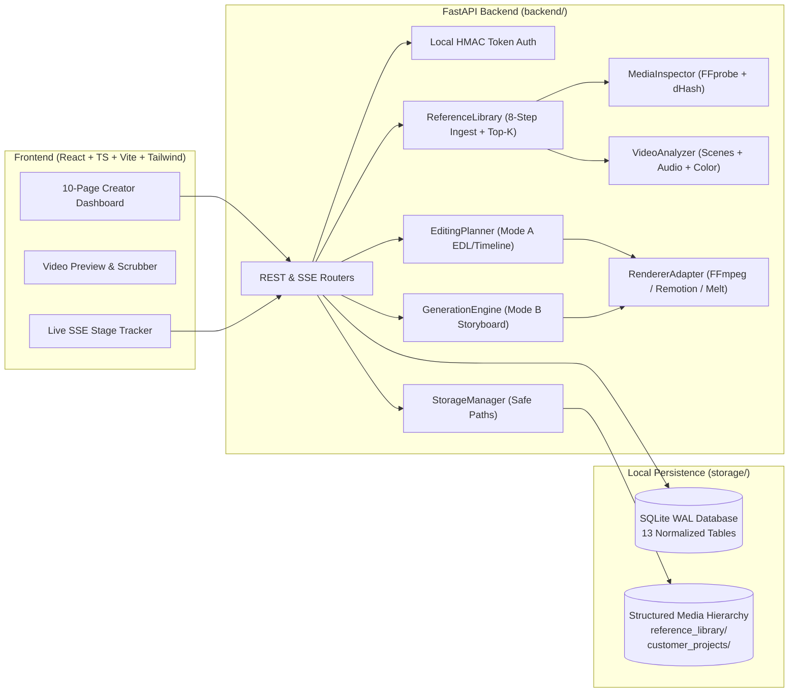
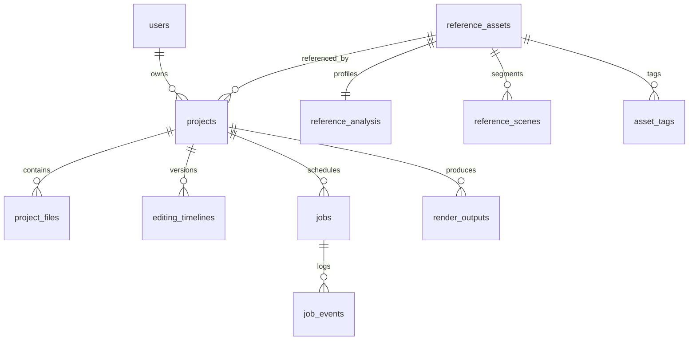

# Unico System Architecture (`ARCHITECTURE.md`)

Unico is architected as a modular, local-first platform optimized for CPU environments without requiring external cloud dependencies, Docker containers, or heavyweight infrastructure such as Redis or PostgreSQL.

---

## 1. High-Level Component Diagram



---

## 2. Normalized Database Schema (13 Tables)

Unico uses SQLite in `WAL` (Write-Ahead Logging) mode with foreign key enforcement (`PRAGMA foreign_keys=ON;`) to allow concurrent reads from the FastAPI web server while the background worker updates job stages.



| Table Name | Primary Responsibility |
| :--- | :--- |
| `users` | Local creator accounts, PBKDF2-HMAC-SHA256 password hashes, and roles |
| `projects` | Mode A (`edit`) and Mode B (`generate`) project state, parameters, and privacy flags |
| `project_files` | Validated customer source uploads, custom references, and thumbnails |
| `jobs` | SQLite-backed background job queue with stage, progress, retry count, and cancellation flags |
| `job_events` | Immutable audit trail of pipeline stage transitions for SSE streaming |
| `reference_assets` | Indexed reference videos with SHA-256, perceptual dHash, codec info, and provenance |
| `reference_analysis` | Extracted style profiles (pacing, avg shot duration, color style, loudness, feature vector) |
| `reference_scenes` | Scene boundary timestamps, durations, representative frames, and shot compositions |
| `asset_tags` | Normalized searchable tags linked to each reference asset |
| `editing_timelines` | Versioned EDL and Timeline JSON documents decoupled from rendering |
| `render_outputs` | Final MP4 and preview proxy metadata validated by FFprobe |
| `generation_templates` | Reusable multi-slot storyboard templates for Mode B generation |
| `system_settings` | Runtime-configurable worker concurrency, preview resolution, and cleanup policies |

---

## 3. Storage Hierarchy & Privacy Boundary

```text
storage/
├── reference_library/           # Shared authorized reference videos (organized dynamically by category/subcategory)
│   ├── animals/
│   │   ├── lions/
│   │   ├── birds/
│   │   ├── wildlife/
│   │   └── pets/
│   ├── humans/
│   ├── nature/
│   ├── cinematic/
│   ├── business/
│   ├── education/
│   ├── technology/
│   └── general/
├── customer_projects/           # Strictly private per-project workspaces
│   └── {project_id}/
│       ├── input/               # Raw customer source video (never modified in place)
│       ├── reference/           # Project-private custom reference uploads
│       ├── analysis/            # Extracted keyframes and source analysis artifacts
│       ├── thumbnails/          # Input and output thumbnails
│       ├── timeline/            # Generated .srt captions and timeline artifacts
│       ├── previews/            # Lightweight 720p/480p proxy previews
│       ├── output/              # Final mastered MP4 exports
│       └── logs/                # Per-project processing logs
├── generated_content/           # Shared generated assets
├── temporary/                   # Ephemeral render segments (auto-cleaned)
└── database/
    └── unico.db                 # SQLite WAL database
```
