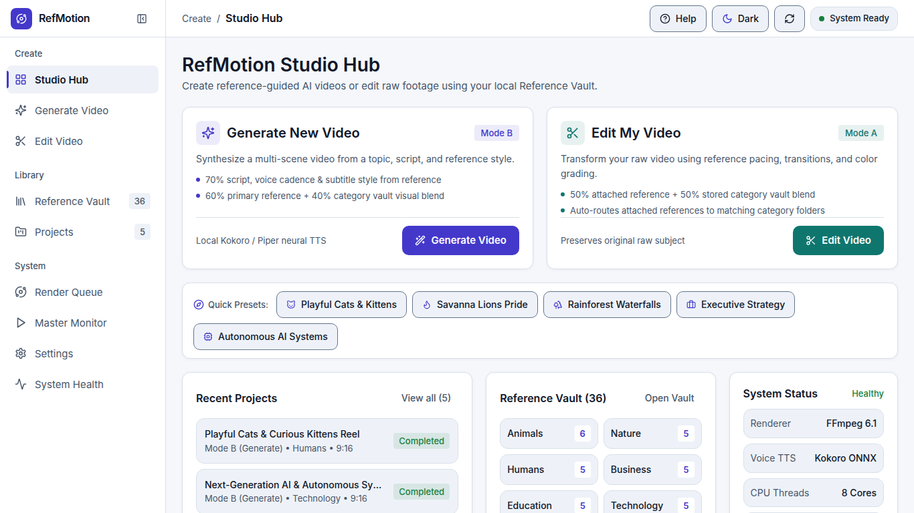
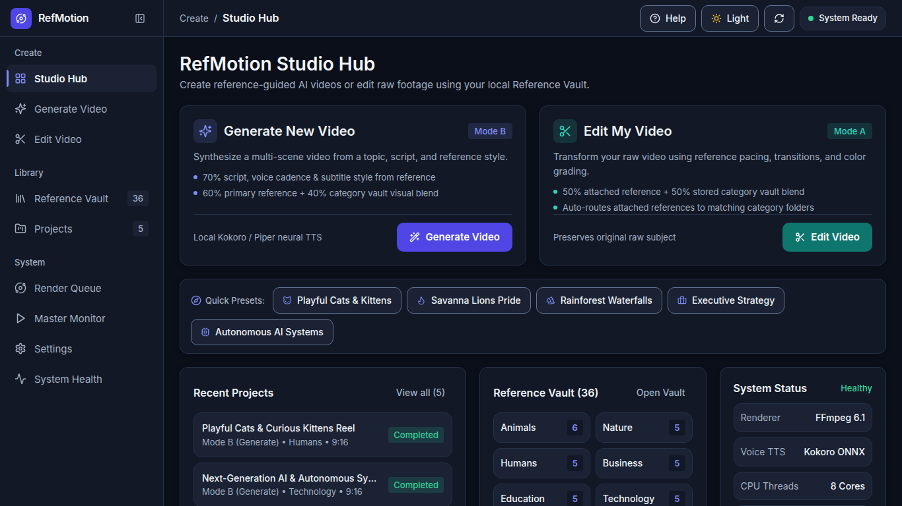
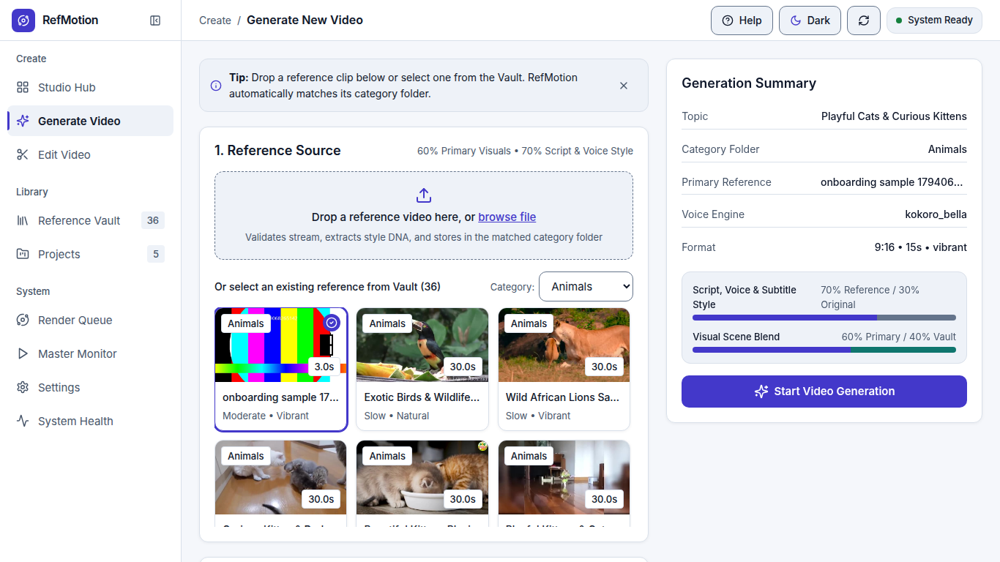
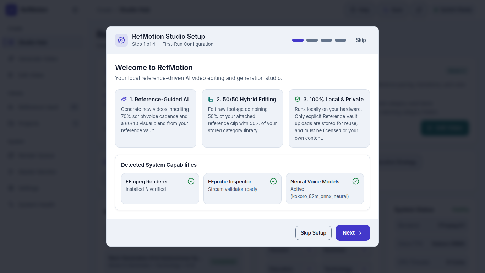
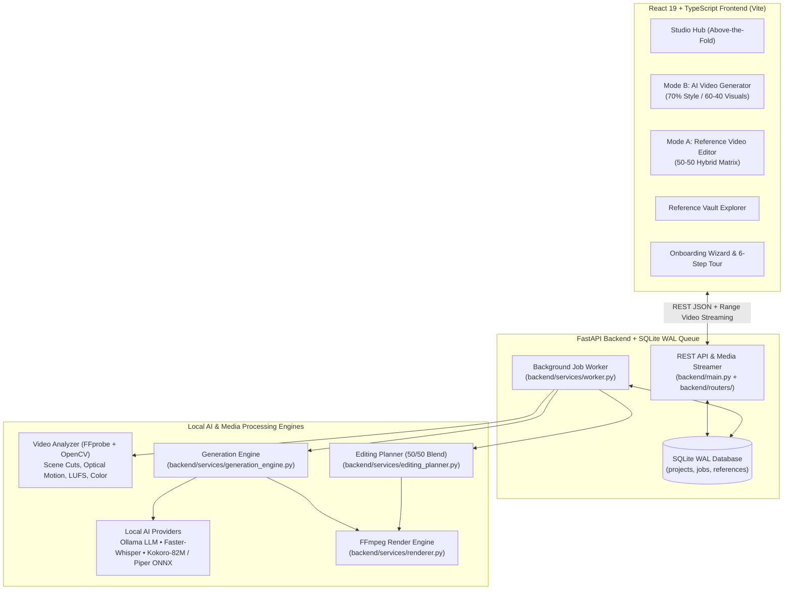

<div align="center">

# RefMotion Studio

### Open-Source AI-Powered Reference-Based Video Generation & Editing Platform

[](LICENSE)
[](https://www.python.org/)
[](https://fastapi.tiangolo.com/)
[](https://react.dev/)
[-16a34a.svg)](frontend/verify_contrast.mjs)
[](https://github.com/arslantariq364/refmotion/pulls)

**RefMotion** is a 100% local, privacy-first AI video production studio engineered to run smoothly on consumer hardware (including 8 GB RAM laptops with CPU-only inference). It empowers creators to **generate novel narrated videos** or **transform raw footage** by extracting pacing, visual color grading, motion cadence, script structure, and subtitle rhythm from reference videos.

[Quick Start](#-quick-start-local-setup) • [Core Capabilities](#-core-capabilities--blending-architecture) • [System Architecture](#-system-architecture) • [API Reference](#-rest-api-endpoints) • [Contributing](#-contributing-for-collaborators)

</div>

---

## Interface Preview

| Light Theme — Studio Hub | Dark Theme — Studio Hub |
| :---: | :---: |
|  |  |

| Mode B — AI Video Generation (`70%` Cadence + `60/40` Visuals) | First-Run 3-Step Onboarding Wizard |
| :---: | :---: |
|  |  |

---

## Core Capabilities & Blending Architecture

RefMotion operates around two core production pipelines backed by an automated **Reference Vault** and **FFmpeg/OpenCV Media Analysis Engine**:

### 1. Mode B: Reference-Driven AI Video Generation
Generate a completely new narrated video from a topic prompt and an optional or selected reference video:
- **70% Reference Style Transfer (Script, Voice Cadence & Subtitles)**: Extracts the narrative hook density, words-per-minute (WPM) speaking speed, sentence rhythm, and burned-in ASS subtitle typography from the reference video.
- **100% Original Self-Synthesized Neural Voiceover**: Never copies or splices the reference audio track. RefMotion generates an original script and synthesizes fresh neural speech locally using **Kokoro-82M ONNX** (`af_heart`, `af_bella`, `am_adam`, `am_michael`, `bf_emma`) or **Piper Neural TTS ONNX**, with automatic fallback to `espeak-ng`.
- **60% Primary Reference + 40% Category Vault Visual Novelty**: Builds a multi-scene timeline combining **60% visual scenes** from your selected/attached primary reference video with **40% complementary scenes** drawn from other references in the same category directory, applying anti-duplication temporal slicing, color-temperature shifting, and dynamic Ken Burns pan/zoom transforms.

### 2. Mode A: Reference-Based Video Editing (`50% / 50%` Hybrid Matrix)
Upload your raw footage and pair it with a reference video to automatically cut, color-grade, caption, and score your video:
- **50% Attached/Selected Reference Video**: Extracts cut pacing, scene durations, luminance/saturation grading, and transition cadence from the reference video you attach or select.
- **50% Stored Title/Category Vault Reference**: Blends those parameters equally (`0.50 / 0.50`) with a title-matched or category-matched reference already indexed in the local Reference Vault.

### 3. Smart Reference Vault & Automatic Directory Routing
- When you drop or upload a reference video in **Mode A** or **Mode B**, RefMotion automatically inspects the filename, title, and category tokens (`animals/cats`, `animals/dogs`, `animals/birds`, `nature`, `humans`, `business`, `education`, `technology`, `cinematic`) via [`resolve_matching_reference_directory`](backend/services/reference_library.py) and archives + indexes the video directly inside the matching `storage/reference_library/<category>/` folder for future reuse.

### 4. HCI-Driven UI, Semantic Theming & Guided Onboarding
- **Dual Semantic Theme Engine**: High-contrast Light and Dark themes defined via CSS custom properties in [`frontend/src/index.css`](frontend/src/index.css) and verified automatically via [`frontend/verify_contrast.mjs`](frontend/verify_contrast.mjs) (`>= 4.5:1` text contrast and `>= 3.0:1` UI border contrast).
- **First-Run Onboarding Wizard**: Detects fresh installations (`reference_count == 0`), checks system readiness (`FFmpeg`, `SQLite WAL`, `Reference Vault`, `Neural TTS`), and lets users seed 3 starter reference videos in one click.
- **Interactive 6-Step Product Tour**: SVG spotlight overlay with keyboard navigation (`←`, `→`, `Esc`) and automatic view switching.
- **3D Isometric Render Telemetry**: Hardware-accelerated CSS 3D stage pipeline (`Ingest -> Analyze -> Plan -> Synthesize -> Encode -> Verify`) with live elapsed timer and log drawer.

---

## System Architecture



---

## Quick Start (Local Setup)

RefMotion is designed so any collaborator can clone the repository and run the full studio locally in under **3 minutes**.

### 1. Prerequisites
- **OS**: Linux (Ubuntu/Debian/Fedora/Arch), macOS, or Windows via WSL2
- **Python**: `3.10+`
- **Node.js**: `18+` (only required if rebuilding the frontend; pre-built assets are included in `frontend/dist`)
- **System Packages**: `ffmpeg` (with `libass` and `libx264`) and `espeak-ng` (optional fallback TTS)

```bash
# Ubuntu / Debian
sudo apt update && sudo apt install -y ffmpeg espeak-ng python3-venv

# macOS (Homebrew)
brew install ffmpeg espeak-ng
```

### 2. Clone the Repository
```bash
git clone https://github.com/arslantariq364/refmotion.git
cd refmotion
```

### 3. Create Virtual Environment & Install Python Dependencies
```bash
python3 -m venv .venv
source .venv/bin/activate
pip install --upgrade pip
pip install -r requirements.txt
```

### 4. Launch RefMotion Studio
You can start the entire platform with the included startup script:
```bash
chmod +x start.sh
./start.sh
```
Then open your browser at:
- **Local Machine**: `http://localhost:8000`
- **LAN Devices**: `http://<your-local-ip>:8000`

> [!TIP]
> **First-Run Onboarding**: When you open `http://localhost:8000` on a fresh clone, the **Welcome to RefMotion** wizard will appear automatically. Click **"Create 3 starter references"** to generate and index 3 sample reference videos (`Animals`, `Nature`, `Technology`) in ~5 seconds and jump straight into a pre-filled demo!

---

## Populating the Reference Library & Local Neural Voice Models

RefMotion includes an automated provisioning script (`scripts/populate_reference_library.py`) that downloads up to 5 real Creative-Commons HD reference videos per category (`animals/cats`, `animals/dogs`, `animals/birds`, `nature`, `humans`, `business`, `education`, `technology`, `cinematic`) along with **Kokoro-82M ONNX** and **Piper Neural TTS** voice models, and indexes every asset into the local SQLite database:

```bash
source .venv/bin/activate
python scripts/populate_reference_library.py
```

You can also upload any `.mp4`, `.mov`, or `.mkv` video directly through the **First-Run Onboarding Wizard**, the **Reference Vault** tab, or the **Mode A / Mode B** dropzones.

---

## Frontend Development & Contrast Verification

If you are modifying the React UI inside `frontend/`:

```bash
cd frontend
npm install

# Run WCAG 2.1 AA token contrast verifier (must pass with 0 violations)
node verify_contrast.mjs

# Build production bundle into frontend/dist (served automatically by FastAPI)
npm run build

# Or run Vite dev server with hot reload
npm run dev
```

---

## Project Directory Structure

```text
refmotion/
├── backend/
│   ├── main.py                      # FastAPI application entrypoint & static/media mounting
│   ├── config.py                    # Path configuration, hardware detection & environment settings
│   ├── database.py                  # SQLite WAL engine & session management
│   ├── models.py                    # SQLAlchemy ORM models (Project, Job, ReferenceAsset, etc.)
│   ├── schemas.py                   # Pydantic request/response schemas
│   ├── auth.py                      # JWT authentication & local studio security helpers
│   ├── routers/
│   │   ├── system.py                # Health, capabilities, settings & onboarding status endpoints
│   │   ├── reference_library.py     # Reference Vault listing, ingestion, search & category matching
│   │   ├── projects.py              # Project CRUD, source/reference uploads, Mode A & Mode B triggers
│   │   ├── jobs.py                  # Job queue listing, SSE progress streaming & cancellation
│   │   └── auth.py                  # Token login & user profile endpoints
│   └── services/
│       ├── media_inspector.py       # Fast FFprobe stream validation & metadata extraction
│       ├── video_analyzer.py        # OpenCV scene cuts, optical motion, LUFS audio & color grading analysis
│       ├── reference_library.py     # Reference Vault indexing, search & auto-directory routing
│       ├── editing_planner.py       # Mode A 50/50 hybrid reference editing timeline planner
│       ├── generation_engine.py     # Mode B 70% style + 60/40 visual blend + original TTS engine
│       ├── renderer.py              # Single-pass FFmpeg filtergraph & ASS subtitle burn-in renderer
│       ├── providers.py             # Local LLM (Ollama), STT (Faster-Whisper), TTS (Kokoro/Piper/espeak)
│       ├── storage_manager.py       # Project workspace & disk quota management
│       └── worker.py                # Asynchronous background job processor with live telemetry
├── frontend/
│   ├── src/
│   │   ├── App.tsx                  # Main application layout, Studio Hub, Mode A/B steppers & Vault
│   │   ├── index.css                # Semantic Light/Dark CSS custom properties & 3D isometric styles
│   │   ├── api.ts                   # Typed REST client & XHR upload progress handler
│   │   ├── types.ts                 # TypeScript interfaces for projects, jobs, references & telemetry
│   │   └── components/
│   │       ├── OnboardingWizard.tsx # First-run 3-step onboarding modal & system check
│   │       ├── WalkthroughTour.tsx  # 6-step spotlight product tour with keyboard navigation
│   │       └── RenderProgressPanel.tsx # 3D isometric stage telemetry & collapsible log drawer
│   └── verify_contrast.mjs          # Automated WCAG 2.1 AA contrast checker for CSS tokens
├── scripts/
│   └── populate_reference_library.py # Curated HD reference video & ONNX neural TTS model downloader
├── storage/
│   └── reference_library/           # Categorized reference folders (animals, nature, business, etc.)
├── tests/
│   └── test_platform.py             # End-to-end pytest suite covering API, analysis, Mode A & Mode B
├── docs/
│   └── screenshots/                 # UI screenshots for documentation
├── ARCHITECTURE.md                  # Deep-dive system architecture & data flow documentation
├── API_DOCUMENTATION.md             # Full REST API reference
├── VIDEO_PROCESSING.md              # FFmpeg filtergraph & analysis pipeline details
├── REFERENCE_PIPELINE.md            # Reference indexing & blending specification
├── INSTALLATION.md                  # Detailed hardware & OS installation guide
├── CONTRIBUTING.md                  # Collaborator guidelines
├── requirements.txt                 # Python dependencies
└── start.sh                         # One-command server startup script
```

---

## REST API Endpoints

| Method | Endpoint | Description |
| :--- | :--- | :--- |
| `GET` | `/api/system/health` | System health check, FFmpeg status, CPU/RAM metrics & active job counts |
| `GET` | `/api/system/capabilities` | Hardware acceleration, local LLM/STT/TTS provider status & blend weights |
| `GET` | `/api/system/onboarding` | First-run onboarding status (`onboarding_complete`, `reference_count`, `sample_preset`) |
| `PUT` | `/api/system/onboarding` | Updates `onboarding_complete` flag in system settings |
| `GET` | `/api/reference-library` | Lists indexed reference videos (filterable by `category`) |
| `POST` | `/api/reference-library/ingest` | Uploads a reference video and auto-routes it to the matching category folder |
| `GET` | `/api/reference-library/match-category` | Previews which Reference Vault directory a filename + category will route to |
| `POST` | `/api/projects` | Creates a new Mode A (`edit`) or Mode B (`generate`) project workspace |
| `POST` | `/api/projects/{id}/upload/source` | Uploads raw source video for Mode A editing |
| `POST` | `/api/projects/{id}/upload/reference` | Uploads an attached reference video and auto-indexes it into the matching Vault directory |
| `POST` | `/api/projects/{id}/edit` | Launches a **Mode A** (`50/50` Attached + Vault Reference) video editing job |
| `POST` | `/api/projects/{id}/generate` | Launches a **Mode B** (`70%` Style + `60/40` Visuals + Neural TTS) generation job |
| `GET` | `/api/jobs` | Lists all Mode A & Mode B jobs with real-time progress and stage telemetry |
| `GET` | `/api/jobs/{id}/events` | Server-Sent Events (SSE) stream for live render progress |

Interactive OpenAPI / Swagger documentation is also available locally at `http://localhost:8000/docs`.

---

## Running Automated Tests

Run the full backend and integration test suite with `pytest`:

```bash
source .venv/bin/activate
pytest tests/test_platform.py -v
```

Run the frontend WCAG contrast audit and TypeScript production build check:

```bash
cd frontend
node verify_contrast.mjs
npm run build
```

---

## Contributing (For Collaborators)

We welcome contributions to make **RefMotion** faster, smarter, and even easier to run on low-resource hardware! See [`CONTRIBUTING.md`](CONTRIBUTING.md) for full details.

### High-Impact Areas for Contributors
1. **Additional Local TTS & Voice Cloning Backends**: Expand [`backend/services/providers.py`](backend/services/providers.py) with additional lightweight ONNX/GGUF speech models or multilingual voice packs.
2. **Beat-Synced Audio Ducking & Transition Shaders**: Enhance [`backend/services/renderer.py`](backend/services/renderer.py) with onset-aligned cut snapping and additional FFmpeg `xfade` shaders.
3. **Vision-Language Scene Tagging**: Integrate ultra-lightweight local VLM/CLIP embeddings in [`backend/services/video_analyzer.py`](backend/services/video_analyzer.py) for semantic shot matching between script sentences and reference clips.
4. **Timeline Fine-Tuning UI**: Add an interactive post-render timeline scrubber in `frontend/src/components/` so creators can tweak individual scene trim points before re-rendering.

### Pull Request Workflow
1. Fork [`arslantariq364/refmotion`](https://github.com/arslantariq364/refmotion) and create a feature branch (`git checkout -b feat/your-feature`).
2. Ensure all backend tests pass (`pytest tests/test_platform.py -v`).
3. If modifying UI styles or components, run `node frontend/verify_contrast.mjs` and `npm --prefix frontend run build` (no emojis in UI components; use `lucide-react` icons and semantic CSS variables).
4. Open a Pull Request with a clear summary and before/after screenshots where applicable.

---

## License

Distributed under the **MIT License**. See [`LICENSE`](LICENSE) for full details.

Created and maintained by **Arslan Tariq** ([@arslantariq364](https://github.com/arslantariq364)).
