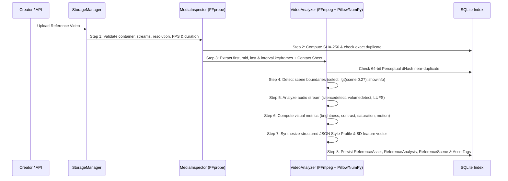

# Reference Library Ingestion & Retrieval Pipeline (`REFERENCE_PIPELINE.md`)

The **Reference Library** (`backend/services/reference_library.py`) is an independent, extensible subsystem responsible for ingesting, validating, fingerprinting, analyzing, indexing, and retrieving reference videos.

---

## 1. Eight-Step Reference Ingestion Pipeline

### Detailed Pipeline Stages

1. **Step 1 — Validation (`inspect_video_file`)**:
   - Inspects container format, video stream (`width`, `height`, `fps`, `codec_name`, `pix_fmt`, `aspect_ratio`), and audio stream (`codec`, `sample_rate`, `channels`).
   - Rejects zero-byte, truncated, or video-less files with HTTP 400.
2. **Step 2 — Video Fingerprinting**:
   - Computes full-file `SHA-256` during streaming upload.
   - Computes a 64-bit difference perceptual hash (`dHash`) on the representative keyframe and checks Hamming distance (`<= 2`) against existing assets of matching resolution and duration to prevent duplicate ingestion (HTTP 409).
3. **Step 3 — Keyframe & Contact Sheet Extraction**:
   - Extracts keyframes at `5%`, `25%`, `50%`, `75%`, and `95%` of duration plus scene midpoints.
   - Generates a composite `contact_sheet.jpg` grid for visual inspection.
4. **Step 4 — Scene Detection**:
   - Runs FFmpeg `select='gt(scene,0.27)',showinfo` to identify real scene cuts and records `start_time`, `end_time`, `duration`, and a representative frame per scene.
5. **Step 5 — Audio Analysis**:
   - Measures mean/max volume (dB / LUFS approximation) and silence intervals via `silencedetect` and `volumedetect` to classify audio profile (`energetic`, `dramatic`, `ambient`, `silent`) and speech presence.
6. **Step 6 — Visual & Motion Analysis**:
   - Evaluates luma brightness, standard-deviation contrast, HSV saturation, dominant hex colors, and inter-frame pixel motion delta on CPU.
7. **Step 7 — Style Profile Generation**:
   - Produces a real, non-fabricated JSON profile capturing `pacing` (`fast`, `moderate`, `slow`), `average_shot_duration`, `cut_rate_per_minute`, `transitions`, `color_style`, and `zoom_effects`.
8. **Step 8 — SQLite Indexing**:
   - Stores normalized records across `reference_assets`, `reference_analysis`, `reference_scenes`, and `asset_tags`.

---

## 2. Top-K Reference Retrieval Engine

When searching (`POST /api/reference-library/search`) or automatically matching references for a customer job:
- Candidates are scored across **Category match** (`+4.0`), **Subcategory match** (`+2.5`), **Aspect ratio match** (`+2.0`), **Pacing & Color style match** (`+1.5` each), **Tag overlap** (`+1.2/tag`), **Keyword query match** (`+1.5/term`), and **Cosine similarity** (`+2.0 * cos_sim`) on the 8-dimensional visual/audio feature vector.
- Returns only the **Top-K** best matches and increments `usage_count` when an asset is used in an editing or generation timeline.

---

## 3. Customer Privacy & Explicit Promotion Rule

- Customer uploads in `storage/customer_projects/{project_id}` are **strictly private** by default (`is_private = True`).
- A customer video is **never** added to `storage/reference_library/` unless the owner explicitly triggers `POST /api/projects/{id}/promote` with `confirm_consent: true`.
