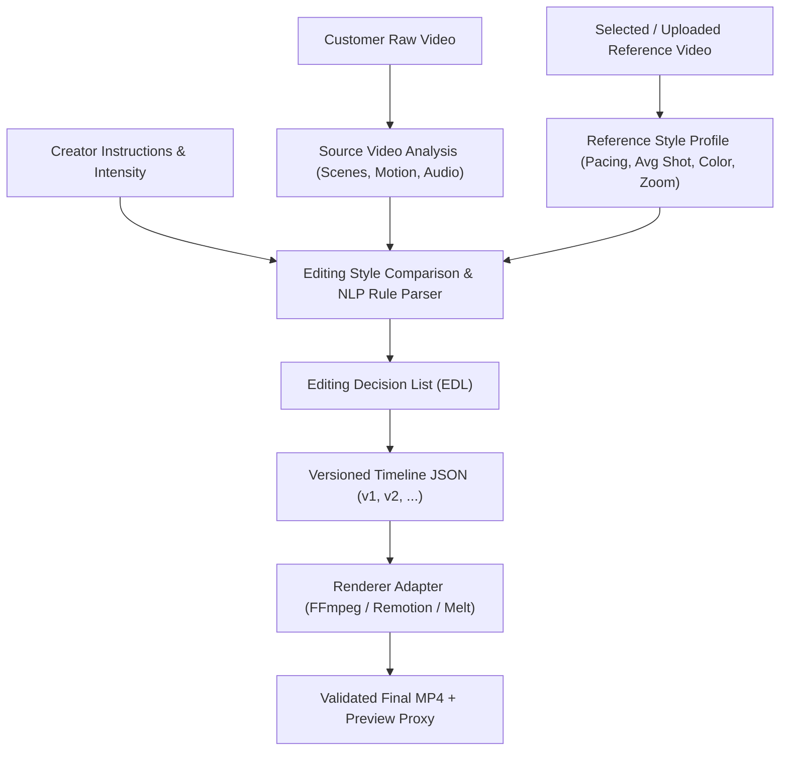

# Video Processing & Rendering Engine (`VIDEO_PROCESSING.md`)

Unico decouples **Editing Intelligence / Planning** from **Video Rendering** through a versioned JSON Timeline specification and a pluggable `BaseRendererAdapter` interface.

---

## 1. Intelligent Editing Pipeline (Mode A)

### Key Principles
- **Never Concatenate Raw + Reference**: The reference video is analyzed strictly to extract its temporal rhythm (shot durations, cut frequency), transition style (`hard_cut`, `fade`), color grade (`cinematic`, `vibrant`, `warm_vintage`, `monochrome`), and zoom dynamics (`subtle_zoom_in`, `subtle_zoom_out`).
- **Non-Destructive Source Handling**: Customer source videos in `customer_projects/{id}/input/` are never modified in place.
- **Fast Timeline Regeneration**: Calling `POST /api/projects/{id}/regenerate-timeline` creates a new `EditingTimeline` version (`v2`, `v3`, ...) instantaneously without re-running reference ingestion.

---

## 2. Template & Local Asset Generation Pipeline (Mode B)

1. **Template Selection**: Matches category-specific storyboards (`Animal Cinematic Template`, `Business Executive Explainer`, `Cinematic Story Showcase`, `Tech & Product Walkthrough`).
2. **Non-Repeating Asset Windowing**: Queries the local Reference Library for Top-K matching assets and selects distinct scene timestamps so identical clip ranges are never repeated back-to-back.
3. **Captions, Voice-Over & Harmonic Backing Audio**:
   - Generates timed `.srt` subtitles from the script or topic.
   - Synthesizes local speech via `espeak-ng` (when enabled) and ambient harmonic backing audio via FFmpeg `lavfi` sine synthesis.

---

## 3. Pluggable Rendering Adapters (`backend/services/renderer.py`)

| Adapter | Engine Name | Role |
| :--- | :--- | :--- |
| `FFmpegRendererAdapter` | `ffmpeg` | **Default Backend**: Executes frame-accurate trimming, aspect-ratio scaling/cropping (`1080x1920`, `1920x1080`, `1080x1080`), EQ/color-balance grading, zoom filters, subtitle burn-in, multi-track audio mixing (`amix`), and `720p`/`480p` preview proxy generation. |
| `RemotionRendererAdapter` | `remotion` | Connects to the local Remotion workspace (`~/launch-video`) for programmatic React motion graphics and animated compositions. |
| `MeltRendererAdapter` | `melt` | Connects to `/usr/bin/melt` (MLT multimedia framework) as an alternative scriptable compositor. |
